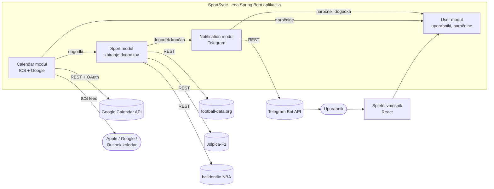

# SportSync – pametni sistem za spremljanje več športov na enem mestu

## 1. Opis projekta

SportSync je spletna aplikacija, v kateri uporabnik izbere športe in ekipe, ki jih spremlja. Sistem iz več zunanjih športnih API-jev samodejno pridobiva njihove dogodke (tekme, dirke), jih vpisuje v uporabnikov koledar (Google Calendar ali Apple Calendar) in po koncu vsakega dogodka pošlje kratek povzetek v Telegram.

**Problem:** športni navdušenec, ki spremlja npr. nogometni klub, Formulo 1 in NBA ekipo, mora razpored preverjati v več različnih aplikacijah. SportSync zbere vse dogodke na enem mestu, v koledarju, ki ga uporabnik že uporablja.

### Glavne funkcionalnosti

| # | Funkcionalnost | Opis |
|---|----------------|------|
| F1 | Registracija in prijava | uporabnik ustvari račun v spletni aplikaciji |
| F2 | Izbira športov in ekip | nogomet (ekipe iz glavnih lig), Formula 1 (izbira sej), NBA (ekipe) |
| F3 | Izbira F1 sej | uporabnik izbere, katere seje želi: treningi, kvalifikacije, sprint, dirka |
| F4 | Koledar – ICS naročnina | osebni URL, na katerega se uporabnik naroči v Apple/Google/Outlook koledarju |
| F5 | Koledar – Google Calendar | neposreden vpis dogodkov v uporabnikov Google koledar (OAuth 2.0) |
| F6 | Povezava s Telegramom | uporabnik poveže svoj Telegram račun z botom |
| F7 | Povzetek po dogodku | po koncu tekme/dirke bot pošlje rezultat in ključne podatke |
| F8 | Tedenski pregled | vsako nedeljo bot pošlje seznam dogodkov za naslednji teden |
| F9 | Ogled dogodkov iz baze | uporabnik vidi razpored in rezultate, ki jih je sport modul že pridobil in shranil; podatkov se ne pridobiva sproti ob vsakem ogledu |

### Obseg prve različice (MVP)

- **Nogomet:** 12 tekmovanj iz brezplačnega paketa football-data.org (Premier League, La Liga, Serie A, Bundesliga, Ligue 1, Liga prvakov …)
- **Formula 1:** vse seje sezone
- **Košarka:** NBA
- Vmesnik aplikacije in obvestila so v angleščini.
- API ključe za football-data.org in balldontlie ima aplikacija (shranjeni kot okoljske spremenljivke na strežniku); uporabniki jih ne vnašajo.

---

## 2. Arhitektura

Sistem je **ena Spring Boot aplikacija**, razdeljena na module (`user`, `sport`, `calendar`, `notification`), plus **spletni vmesnik** (React) in **pet zunanjih storitev**. Moduli znotraj aplikacije komunicirajo z direktnimi Java klici (ni REST-a med njimi), z zunanjim svetom pa aplikacija govori prek REST API-ja (JSON).



### Moduli aplikacije

Vsak modul je ločen Java paket (controller, service, repository) znotraj iste Spring Boot aplikacije; med seboj kličejo drug drugega neposredno (Spring bean injection), ne prek REST-a. Navzven aplikacija izpostavlja en skupen REST API (en port).

| Modul | Odgovornost | Glavne končne točke (osnutek) |
|-------|-------------|-------------------------------|
| **user** | uporabniki, prijava (JWT), naročnine na ekipe in F1 seje, povezava s Telegramom in Google računom | `POST /api/auth/register`, `POST /api/auth/login`, `GET/PUT /api/users/me/subscriptions`, `GET /api/subscriptions?teamId=…` |
| **sport** | adapterji za zunanje športne API-je, pretvorba v **skupen format dogodka**, periodično osveževanje razporeda, preverjanje rezultata po končanem dogodku | `GET /api/teams?sport=…`, `GET /api/events?teamIds=…&from=…&to=…`, `GET /api/events/{id}` |
| **calendar** | generiranje ICS koledarja za uporabnika, sinhronizacija dogodkov v Google Calendar | `GET /calendar/{token}.ics`, `POST /api/calendar/google/sync` |
| **notification** | sestavljanje in pošiljanje Telegram sporočil (povzetek, tedenski pregled), sprejem ukazov bota | `POST /api/notifications/event-finished`, `POST /telegram/webhook` |

**Baza:** ena skupna PostgreSQL baza (ločen strežniški proces, npr. v Docker containerju); vsak modul uporablja svoje tabele v isti bazi.

### Adapterji v sport modulu

Vsak zunanji vir ima svoj adapter, ki odgovor API-ja pretvori v skupen objekt `SportEvent`. Ostali moduli vedo samo za ta skupen format, ne za posamezne API-je. Nov šport (npr. Evroliga) se doda z novim adapterjem brez sprememb v drugih modulih.

```
SportAdapter (vmesnik)
├── FootballDataAdapter   → football-data.org
├── JolpicaF1Adapter      → Jolpica-F1
└── BallDontLieAdapter    → balldontlie (NBA)
```

---

## 3. Tokovi podatkov

### 3.1 Uporabnik izbere ekipe

1. Uporabnik se prijavi v spletni vmesnik.
2. Vmesnik pri **sport modulu** pridobi seznam ekip (`GET /api/teams?sport=FOOTBALL`).
3. Uporabnik izbere ekipe in F1 seje; vmesnik izbiro shrani v **user modulu**.
4. User modul vrne osebni URL koledarja (`/calendar/{token}.ics`).

### 3.2 Osveževanje razporeda (periodično, npr. vsakih 6 ur)

1. **Sport modul** za vsak šport pokliče zunanji API (razpored tekem/dirk) s ključem aplikacije (iz env), v enem klicu za celotno datumsko obdobje (ne po ekipah ali uporabnikih), glej [zunanje-storitve.md](zunanje-storitve.md#pridobivanje-rezultata-po-dogodku).
2. Adapter odgovor pretvori v `SportEvent` in ga shrani (nov ali posodobljen termin).
3. **Calendar modul** pri Google uporabnikih vpiše nove dogodke oziroma posodobi spremenjene.
4. ICS feed se generira ob vsakem zahtevku koledarske aplikacije, zato je vedno aktualen.

### 3.3 Povzetek po dogodku

Aplikacija ne spremlja dogodkov v živo — namen je povedati, kdaj je dogodek (vnos v koledar), in na koncu poslati povzetek, zato se med samim potekom dogodka ne preverja nič posebnega:

1. **Sport modul** za dogodke, ki jim je minil ocenjeni `endTime` in še nimajo statusa `FINISHED`, občasno (npr. vsakih 10–15 minut) preveri status pri zunanjem API-ju (en klic za vse take dogodke skupaj, ne posebej za vsakega uporabnika).
2. Ko je status `FINISHED`, sport modul pridobi končni rezultat in pokliče **notification modul** (interni klic, ustreza nekdanji `POST /api/notifications/event-finished`).
3. Notification modul pri **user modulu** pridobi uporabnike, ki spremljajo ta dogodek.
4. Za vsakega sestavi sporočilo po predlogi in ga pošlje prek **Telegram Bot API**.

### 3.4 Tedenski pregled (vsako nedeljo ob 20:00)

1. Notification modul za vsakega uporabnika pridobi njegove naročnine (user modul).
2. Pri sport modulu pridobi dogodke za naslednjih 7 dni.
3. Pošlje seznam v Telegram.

### 3.5 Povezava Telegrama

1. Uporabnik v vmesniku klikne »Connect Telegram«; dobi povezavo `https://t.me/<bot>?start=<enkratna_koda>`.
2. Telegram botu pošlje `/start <enkratna_koda>`, Telegram to posreduje na naš webhook.
3. Notification modul kodo preveri pri user modulu in shrani `chat_id` uporabnika.

---

## 4. Tehnologije

| Del | Tehnologija |
|-----|-------------|
| Zaledje | Java 21, Spring Boot 3 (Web, Data JPA, Security, Scheduling) |
| HTTP klient | Spring `RestClient` |
| Baza | PostgreSQL |
| ICS | knjižnica ical4j |
| Spletni vmesnik | React (Vite) |
| Zagon | Docker Compose (Spring Boot aplikacija + PostgreSQL container) |
| Secreti (JWT ključ, Google OAuth, Telegram bot token, API ključi football-data.org/balldontlie) | okoljske spremenljivke (`.env` / `application.yml` placeholderji), ne v izvorni kodi |

---

## 5. Dokumentacija

- [Opis podatkov](docs/podatki.md) – entitete, formati, tipi, primeri dokumentov
- [Zunanje storitve](docs/zunanje-storitve.md) – uporabljeni API-ji, avtentikacija, omejitve, končne točke

---

## 6. Okvirni načrt dela

| Faza | Vsebina |
|------|---------|
| 1 | Izbira projekta, načrt, dokumentacija (ta naloga) |
| 2 | sport modul: adapterji za football-data.org, Jolpica-F1, balldontlie; skupen format dogodka |
| 3 | user modul: registracija, prijava, naročnine |
| 4 | calendar modul: ICS feed, nato Google Calendar |
| 5 | notification modul: Telegram bot, povzetki, tedenski pregled |
| 6 | Spletni vmesnik (React) |
| 7 | Povezava vseh modulov, testiranje, zagon prek Docker Compose (aplikacija + PostgreSQL) |
