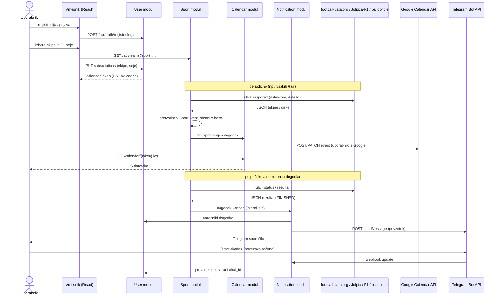

# Zunanje storitve

Pregled zunanjih storitev, ki jih SportSync uporablja. Za vsako so navedeni namen, dokumentacija, avtentikacija, omejitve brezplačnega paketa in končne točke, ki jih bomo klicali.

*Podatki o paketih in omejitvah so preverjeni oktobra 2026 na uradnih straneh ponudnikov in se lahko spremenijo.*

## Povzetek

| Storitev | Namen | Oblika | Avtentikacija | Brezplačna omejitev |
|----------|-------|--------|---------------|---------------------|
| football-data.org | nogomet: ekipe, tekme, rezultati, lestvice | REST, JSON | API ključ aplikacije (glava) | 10 zahtevkov/min, 12 tekmovanj |
| Jolpica-F1 | Formula 1: koledar sej, rezultati | REST, JSON | brez | 4 zahtevki/s, 500 zahtevkov/h |
| balldontlie (NBA) | NBA: ekipe, tekme, rezultati | REST, JSON | API ključ aplikacije (glava) | 5 zahtevkov/min |
| Google Calendar API | vpis dogodkov v uporabnikov koledar | REST, JSON | OAuth 2.0 | dovolj za naš obseg |
| Telegram Bot API | pošiljanje povzetkov, povezava uporabnika | REST, JSON | žeton bota v URL-ju | dovolj za naš obseg |

Poleg tega calendar modul sam **ponuja** koledar v standardni obliki iCalendar (RFC 5545), ki ga berejo Apple Calendar, Google Calendar in Outlook. To ni zunanji API, ampak standard, ki ga moramo upoštevati.

---

## Diagram interakcije

---

## 1. football-data.org

**Namen:** razpored in rezultati nogometnih tekem, seznam ekip, lestvice.

- Spletna stran: https://www.football-data.org
- Dokumentacija (v4): https://docs.football-data.org
- Hiter začetek: https://www.football-data.org/documentation/quickstart
- Pokritost: https://www.football-data.org/coverage
- Osnovni URL: `https://api.football-data.org/v4`

**Avtentikacija:** brezplačna registracija, ključ se pošlje v glavi `X-Auth-Token: <API_KEY>`. Ključ je lasten aplikaciji (en ključ na strežniku, shranjen kot okoljska spremenljivka), ne posameznim uporabnikom.

**Brezplačni paket:**
- 12 tekmovanj: Premier League, Championship, La Liga, Serie A, Bundesliga, Ligue 1, Eredivisie, Primeira Liga, Liga prvakov, brazilska Serie A, svetovno in evropsko prvenstvo
- razpored, rezultati (z zamikom) in lestvice
- 10 zahtevkov na minuto
- **ni** strelcev, postav in kartonov (plačljiv paket »Deep Data«), zato povzetek vsebuje rezultat, polčas in lestvico

**Uporabljene končne točke:**

| Končna točka | Uporaba |
|--------------|---------|
| `GET /v4/competitions/{code}/teams` | seznam ekip tekmovanja za izbiro v vmesniku (npr. `PL`, `PD`, `SA`, `BL1`, `FL1`, `CL`) |
| `GET /v4/teams/{id}/matches?dateFrom=…&dateTo=…` | razpored tekem izbrane ekipe |
| `GET /v4/matches?dateFrom=…&dateTo=…` | vse tekme v obdobju (manj klicev kot po ekipah) |
| `GET /v4/matches/{id}` | stanje in rezultat posamezne tekme |
| `GET /v4/competitions/{code}/standings` | lestvica za povzetek |

**Pomembna polja v odgovoru tekme:** `id`, `utcDate`, `status` (`SCHEDULED`, `TIMED`, `IN_PLAY`, `PAUSED`, `FINISHED`, `POSTPONED`, `SUSPENDED`, `CANCELLED`), `homeTeam`, `awayTeam`, `score.fullTime`, `score.halfTime`, `competition`.

**Ukrep zaradi omejitve:** klici se združujejo po datumskem obdobju (en klic za vse spremljane tekme hkrati, ne po ekipah ali uporabnikih), rezultati se predpomnijo v bazi sport modula, zato omejitev ni odvisna od števila uporabnikov (glej [spodaj](#pridobivanje-rezultata-po-dogodku)).

---

## 2. Jolpica-F1

**Namen:** koledar F1 sezone s časi vseh sej ter rezultati kvalifikacij, sprinta in dirke. Jolpica je odprtokodni naslednik ukinjenega Ergast API-ja in ima z njim združljive končne točke.

- Repozitorij: https://github.com/jolpica/jolpica-f1
- Dokumentacija: https://github.com/jolpica/jolpica-f1/blob/main/docs/README.md
- Omejitve: https://github.com/jolpica/jolpica-f1/blob/main/docs/rate_limits.md
- Osnovni URL: `https://api.jolpi.ca/ergast/f1`

**Avtentikacija:** ni potrebna. Zahtevana je lastna glava `User-Agent`, npr. `SportSync/1.0`.

**Omejitve:** 4 zahtevki na sekundo in 500 zahtevkov na uro (napovedano je, da se bodo za dostop brez žetona zmanjšale).

**Uporabljene končne točke:**

| Končna točka | Uporaba |
|--------------|---------|
| `GET /{season}/races/` | koledar sezone; vsaka dirka vsebuje objekte `FirstPractice`, `SecondPractice`, `ThirdPractice`, `Qualifying`, `SprintQualifying`, `Sprint` z `date` in `time` (UTC) |
| `GET /{season}/{round}/qualifying/` | rezultati kvalifikacij |
| `GET /{season}/{round}/sprint/` | rezultati sprinta |
| `GET /{season}/{round}/results/` | rezultati dirke (vključno z najhitrejšim krogom) |

Vse končne točke se končajo z `/` ali `.json`. Odgovor je zavit v objekt `MRData`, npr. `MRData.RaceTable.Races[]`.

**Omejitev za projekt:** Jolpica ne vrača rezultatov treningov, zato so treningi samo v koledarju, brez povzetka.

**Alternativa:** [OpenF1](https://openf1.org) (brez ključa, podatki od sezone 2023, 30 zahtevkov/min) ima tudi rezultate treningov in se lahko doda kot drugi vir.

---

## 3. balldontlie (NBA)

**Namen:** seznam NBA ekip, razpored in rezultati tekem.

- Spletna stran: https://www.balldontlie.io
- Dokumentacija NBA: https://docs.balldontlie.io
- Specifikacija OpenAPI: https://www.balldontlie.io/openapi/nba.yml
- Osnovni URL: `https://api.balldontlie.io/v1`

**Avtentikacija:** brezplačna registracija, ključ v glavi `Authorization: <API_KEY>`. Ključ je lasten aplikaciji (en ključ na strežniku, shranjen kot okoljska spremenljivka), ne posameznim uporabnikom.

**Brezplačni paket:** končne točke `Teams`, `Players` in `Games`; 5 zahtevkov na minuto. Statistika igralcev, lestvice in box score so v plačljivih paketih, zato povzetek vsebuje rezultat in rezultat po četrtinah (ta je v odgovoru `Games`).

**Uporabljene končne točke:**

| Končna točka | Uporaba |
|--------------|---------|
| `GET /teams` | seznam ekip za izbiro v vmesniku |
| `GET /games?team_ids[]=…&start_date=…&end_date=…` | razpored izbranih ekip |
| `GET /games?dates[]=YYYY-MM-DD` | vse tekme dneva (preverjanje rezultatov) |
| `GET /games/{id}` | posamezna tekma |

**Pomembna polja tekme:** `id`, `datetime` (UTC), `status_state` (`scheduled`, `in_progress`, `final`, `postponed`, `canceled` …), `home_team`, `visitor_team`, `home_team_score`, `visitor_team_score`, `home_q1`–`home_q4`, `visitor_q1`–`visitor_q4`, `postseason`.

**Paginacija:** s kazalcem (`meta.next_cursor`, parameter `cursor`), največ 100 zapisov na stran.

**Ukrep zaradi omejitve:** pri 5 zahtevkih na minuto se razpored osvežuje redko (npr. enkrat dnevno), rezultati pa se preverjajo z enim klicem za cel dan (`dates[]`), ne glede na število uporabnikov (glej [spodaj](#pridobivanje-rezultata-po-dogodku)).

---

## 4. Google Calendar API

**Namen:** neposreden vpis, posodobitev in brisanje dogodkov v uporabnikovem Google koledarju.

- Dokumentacija: https://developers.google.com/calendar/api/guides/overview
- Referenca `Events`: https://developers.google.com/calendar/api/v3/reference/events
- OAuth 2.0 za spletne strežnike: https://developers.google.com/identity/protocols/oauth2/web-server
- Osnovni URL: `https://www.googleapis.com/calendar/v3`

**Avtentikacija:** OAuth 2.0. Uporabnik v vmesniku klikne »Connect Google Calendar«, potrdi dostop, mi pa shranimo `refresh_token`. Projekt je treba registrirati v Google Cloud Console. Obseg (scope): `https://www.googleapis.com/auth/calendar.events`.

**Uporabljene končne točke:**

| Končna točka | Uporaba |
|--------------|---------|
| `POST /calendars/primary/events` | nov dogodek |
| `PATCH /calendars/primary/events/{eventId}` | sprememba termina |
| `DELETE /calendars/primary/events/{eventId}` | odpovedan dogodek ali odjava od ekipe |

**Opomba:** dokler aplikacija v Google Cloud ni preverjena, se lahko povežejo le uporabniki, dodani kot testni uporabniki. Za študijski projekt to zadošča.

---

## 5. Telegram Bot API

**Namen:** pošiljanje povzetkov po dogodkih in tedenskega pregleda; povezava Telegram računa z uporabnikom.

- Dokumentacija: https://core.telegram.org/bots/api
- Uvod za razvijalce: https://core.telegram.org/bots
- Osnovni URL: `https://api.telegram.org/bot<TOKEN>/`

**Avtentikacija:** žeton bota, ki ga dobimo pri @BotFather; vključen je v URL.

**Uporabljene metode:**

| Metoda | Uporaba |
|--------|---------|
| `sendMessage` | pošiljanje povzetka ali pregleda (`chat_id`, `text`, `parse_mode: HTML`) |
| `setWebhook` | nastavitev URL-ja, na katerega Telegram pošilja nova sporočila botu |
| sprejem `Update` (webhook) | ukaz `/start <koda>` za povezavo računa |

**Povezava računa:** povezava `https://t.me/<ime_bota>?start=<koda>` odpre pogovor z botom in samodejno pošlje `/start <koda>`. Tako vemo, kateremu uporabniku pripada `chat_id`.

**Opomba za lokalni razvoj:** webhook zahteva javni HTTPS naslov. Med razvojem se lahko namesto njega uporablja metoda `getUpdates` (periodično branje novih sporočil).

---

## 6. Standard iCalendar (RFC 5545)

**Namen:** naročniški koledar, ki deluje v vseh večjih koledarskih aplikacijah (Apple Calendar, Google Calendar, Outlook).

- Specifikacija: https://datatracker.ietf.org/doc/html/rfc5545
- Java knjižnica: https://www.ical4j.org

Calendar modul na naslovu `/calendar/{token}.ics` vrne datoteko z dogodki (glej [opis podatkov](podatki.md#7-ics-koledar-calendar-modul--koledarska-aplikacija)). Koledarske aplikacije naročnino osvežujejo same (običajno na nekaj ur), zato dodatna integracija ni potrebna.

---

## Pridobivanje rezultata po dogodku

Aplikacija dogodkov ne spremlja v živo — namen je povedati, kdaj je dogodek (vnos v koledar), in po koncu poslati kratek povzetek. Med samim potekom dogodka zato ni nobenega posebnega preverjanja, preverjata se le dva primera:

1. **Pred dogodkom** (`status = SCHEDULED`) — razpored in status se osvežujeta skupaj z rednim osveževanjem razporeda (npr. vsakih 6 ur), brez posebne obravnave.
2. **Po pričakovanem koncu** (`endTime` je v preteklosti, `status` še ni `FINISHED`) — sport modul občasno (npr. vsakih 10–15 minut) preveri pri zunanjem API-ju, ali je dogodek že `FINISHED`, ker se dejanski konec lahko razlikuje od ocenjenega (podaljšek, zamik začetka …). Ko je `FINISHED`, pridobi končni rezultat, dogodek izloči iz tega preverjanja in pokliče notification modul (glej [podatki.md](podatki.md#obvestilo-o-koncu-dogodka-notification-modul)).

Ker sport modul podatke pridobiva z enim klicem za celotno datumsko obdobje oziroma cel dan (ne po ekipah ali uporabnikih) in jih predpomni v skupni bazi, omejitev zahtevkov aplikacijskega ključa (10/min football-data.org, 5/min balldontlie) ni odvisna od tega, koliko uporabnikov sistem uporablja.

---

## Zakaj ne Sofascore, Flashscore ipd.

Te storitve nimajo uradnega javnega API-ja. Njihove interne končne točke so zaščitene, se spreminjajo in jih ni dovoljeno uporabljati, zato zanje ne gradimo. Izbrane storitve imajo javno dokumentacijo in brezplačne pakete.
